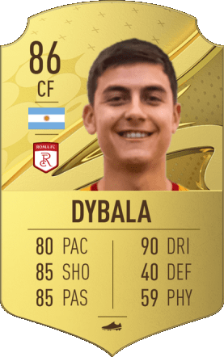
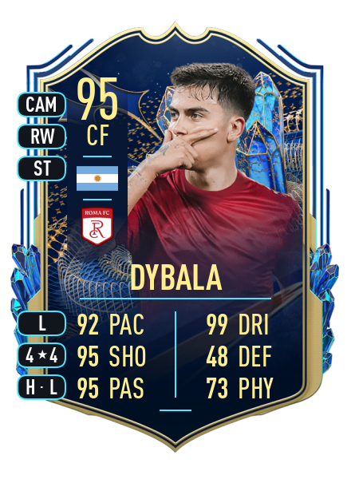

```{r}
#| label: setup
#| include: false
library(palmerpenguins)
library(ggplot2)
```

# Una domanda per cominciare

## {.center}

::: {.domanda}
Nel 2026, che bisogno c'è di sapere come funzionano questi strumenti, quando possiamo far fare tutto all'AI?
:::


## Il programma di oggi

1. Due modi di scrivere un documento: **WYSIWYG** e **WYSIWYM**
2. **R Markdown**: un report che si aggiorna da solo
3. **Quarto**: come R Markdown, ma meglio
4. **Esercizio**: creiamo insieme il nostro primo file
5. **Template**: dove trovarli e cosa controllare
6. **Esercizio per casa** e risposta alla domanda di apertura

::: {.box .piccolo}
La frequenza a questo seminario è vivamente consigliata a un pubblico di statistici che vogliono scrivere report belli, leggibili e facili da replicare
:::


# WYSIWYG e WYSIWYM

## Non mi è saltato il gatto sulla tastiera...
#### sono due modi di scrivere documenti

:::: {.columns}

::: {.column width="50%"}
### WYSIWYG
*What You See Is What You Get*

- vedete già il documento come apparirà stampato
- la formattazione si decide **a mano** durante la stesura

::: {.box .piccolo}
Word, Google Docs, PowerPoint
:::

:::

::: {.column width="50%"}
### WYSIWYM
*What You See Is What You Mean*

- scrivete il contenuto e gli assegnate un ruolo: titolo, sezione
- l'aspetto finale lo decide **separatamente** un foglio di stile

::: {.box .piccolo}
LaTeX, LyX, Markdown
:::

:::

::::


## Metti la cera, togli la cera, metti la cera...
#### Ovvero, come posso creare titoli sempre uguali per tutte le sezioni?

:::: {.columns}

::: {.column .fragment width="33%"}
**Word**

Seleziono "Risultati", scelgo Arial, 16 pt, grassetto, spaziatura prima 12 pt...

<span class="grigio piccolo">...e lo rifaccio per ogni sezione.</span>
:::

::: {.column .fragment width="33%"}
**LaTeX**

```LaTeX
\section{Risultati}
```
:::

::: {.column .fragment width="33%"}
**Markdown**

```markdown
## Risultati
```
:::

::::

. . .

::: {.box}
In LaTeX e in Markdown non impostiamo a mano *come* deve apparire "Risultati": lo definiamo in quanto **sezione**.
:::


## Bello tutto... ma a cosa mi serve?

Separare il **contenuto** dalla **forma** significa che:

- lo stesso contenuto può diventare un PDF, una pagina web o un file Word, **senza riscriverlo**
- tutte le sezioni, le figure e le tabelle hanno lo stesso aspetto, **senza fatica**
- mentre scriviamo pensiamo solo a cosa dire

. . .

Scrivere un report che si aggiorna "internamente" significa che:

- **replicare** i risultati diventa facile, veloce e senza errori
- posso cambiare i dati e ottenere risultati aggiornati di conseguenza in automatico


## A day in the life: PhD student @ DSS
#### Ovvero, per cosa li uso io?

- Slides per lezioni o presentazioni (come queste!)
- Dispense per lezioni (in html o pdf)
- sito web personale <https://andyvaia.github.io/>
- report che si aggiornano ogni volta che ho nuovi dati (in Word, su grande richiesta dei medici)


## A proposito di report che si aggiornano...

Il modo base di scrivere un report:

1. faccio l'analisi in R
2. copio tabelle e numeri in Word (o LaTeX), salvo i grafici come immagini e li incollo

E se **i dati cambiano**?? Rifaccio tutto da capo e riscrivo il testo, sperando di non dimenticare nulla

. . .

::: {.box}
L'idea di R Markdown: mettere **il codice dentro il documento**. Tabelle, grafici e numeri vengono ricalcolati ogni volta che il documento viene compilato.
:::


# R Markdown

## In principio era Sweave...

:::: {.columns}

::: {.column width="50%"}
**Sweave** (2002): LaTeX + R

```LaTeX
\section{Risultati}
La media del campione è
\Sexpr{mean(x)}.

<<grafico, fig=TRUE>>=
hist(x)
@
```
:::

::: {.column width="50%"}
**R Markdown** (~2012): Markdown + R

````markdown
## Risultati
La media del campione è
`r knitr::inline_expr("mean(x)")`.

```{{r}}
hist(x)
```
````
:::

::::

R Markdown è, in sostanza, **LaTeX + R**, con LaTeX sostituito da un linguaggio più semplice (Markdown) e con la possibilità di produrre non solo PDF.


## Com'è fatto un file `.Rmd`

Il file `.Rmd` è costruito a partire da:

:::: {.columns}

::: {.column .fragment style="width: 50%; text-align: center;"}

- un'**intestazione YAML** (tra i `---`)
  - specifico titolo, autore, formato di uscita 
- il **testo** in Markdown
  - posso usare sia la sintassi Markdown che LaTeX
- **chunk** di codice R (tra ```` ``` ````)
  - per ciascuno posso specificare delle opzioni

:::

::: {.column .fragment style="width: 50%; text-align: center;"}
````markdown
---
title: "Il mio report"
output: html_document
---

## Introduzione

Testo in **Markdown**, con formule come in LaTeX: $\bar{x}$.

```{{r grafico, echo=FALSE, fig.cap="Un istogramma"}}
hist(rnorm(100))
```
````
:::

::::


## Cosa succede dietro le quinte

```{mermaid}
%%| echo: false
%%| fig-width: 10
flowchart LR
  A[".Rmd / .qmd"] -->|knitr esegue il codice R| B[".md"]
  B -->|pandoc converte| C["HTML"]
  B --> D["PDF (via LaTeX)"]
  B --> E["Word"]
```

1. **knitr** esegue i chunk e scrive un file Markdown con testo, codice e risultati
2. **pandoc** converte il Markdown nel formato finale

A noi basta premere il pulsante **Knit** (R Markdown).


# Quarto

## Come nasce e che cos'è Quarto?

> Quarto è la nuova generazione di R Markdown: lo **unifica** e lo **estende**.

- non è un pacchetto di R, ma un **programma** a sé, già incluso in RStudio
- per R usa sempre **knitr**: quasi tutti i file `.Rmd` si compilano senza modifiche
- funziona anche con Python e Julia (*multi-language and multi-engine*)
- un'unica sintassi per documenti, presentazioni, siti, libri


## Il glow-up di R Markdown

L'evoluzione tra i due programmi spiegata con una metafora:

:::: {.columns}

::: {.column .fragment style="width: 50%; text-align: center;"}
{height="400px"}

**R Markdown**
:::

::: {.column .fragment style="width: 50%; text-align: center;"}
{height="400px"}

**Quarto**
:::

::::

## Da R Markdown a Quarto (spiegato seriamente!)

:::: {.columns}

::: {.column width="50%"}
**R Markdown** (`.Rmd`)

````markdown
---
title: "Pinguini"
output:
  html_document:
    toc: true
---

```{{r grafico, fig.cap="Becco"}}
plot(penguins$bill_length_mm)
```
````
:::

::: {.column width="50%"}
**Quarto** (`.qmd`)

````markdown
---
title: "Pinguini"
format:
  html:
    toc: true
---

```{{r}}
#| label: fig-grafico
#| fig-cap: "Becco"
plot(penguins$bill_length_mm)
```
````
:::

::::

- `output:` diventa **`format:`**, con nomi brevi: `html`, `pdf`, `docx`
- le opzioni dei chunk si scrivono **dentro** il chunk, una per riga, dopo `#|`
- si compila con il pulsante **Render**

## Cosa aggiunge Quarto

| Cosa voglio produrre | Quarto | R Markdown |
|---|---|---|
| Documento | `html`, `pdf`, `docx`, `typst` | `html_document`, `pdf_document`, ... |
| Presentazione | `revealjs`, `beamer`, `pptx` | xaringan, ioslides, ... (pacchetti diversi) |
| Richiami a figure e tabelle | inclusi | pacchetto bookdown |
| Sito, blog, libro | inclusi | blogdown, bookdown, distill |

. . .

::: {.box}
Queste slide sono un file `.qmd`: lo trovate nel materiale del seminario.
:::


## Prima di iniziare

**RStudio** aggiornato: Quarto è già incluso.

I pacchetti che useremo, dalla *Console*:

```{r}
#| eval: false
install.packages(c("palmerpenguins", "ggplot2", "quarto"))
```

Per il **PDF** serve LaTeX. Se non lo avete, dalla scheda *Terminal* di RStudio:

```bash
quarto install tinytex
```

::: {.piccolo .grigio}
In alternativa usate `format: typst`, che produce un PDF senza LaTeX. Per controllare che tutto funzioni: `quarto check`, sempre nel *Terminal*.
:::


# Esercizio: il mio primo report Quarto

## 1. Creare un nuovo documento

In RStudio: **File → New File → Quarto Document...**

- scrivete un titolo e il vostro nome
- formato: **HTML**
- *engine*: **Knitr**
- **togliete** la spunta da *Use visual markdown editor*
- salvate il file come `primo-documento.qmd`

Poi premete **Render** (o `Ctrl/Cmd + Shift + K`).


## 2. L'intestazione YAML

```yaml
---
title: "Il mio primo documento Quarto"
author: "Nome Cognome"
date: today
lang: it
format: html
---
```

- ogni riga è una coppia `chiave: valore`
- `lang: it` traduce "Figure", "Table", "Contents" in italiano
- **attenzione all'indentazione**: in YAML gli spazi contano (si usano due spazi, mai il tab)


## 3. Il testo

| Cosa scrivo (What you see) | Cosa intendo (What you mean)|
|---|---|
| `## Titolo` | il titolo di una sezione |
| `**grassetto**`, `*corsivo*` | **grassetto**, *corsivo* |
| `- primo punto` | un elenco puntato |
| `[Quarto](https://quarto.org)` | un link: [Quarto](https://quarto.org) |
| `$\bar{x} = \frac{1}{n}\sum x_i$` | $\bar{x} = \frac{1}{n}\sum x_i$ |

Le formule si scrivono **come in LaTeX**: `$...$` nel testo, `$$...$$` su una riga a parte. Potete anche usare `\equation{...}, \align{...}`.


## Esercizio 1: personalizzare il documento
Lavoreremo con il dataset `palmerpenguins`, un famosissimo database che riporta le misure biometriche (becco, pinna, massa corporea) e il sesso di 344 pinguini di tre specie (Adelie, Chinstrap e Gentoo), osservati tra il 2007 e il 2009 su tre isole dell’arcipelago di Palmer, in Antartide. Il dataset accompagna un paper del 2014 (Gorman, Williams e Fraser), che studia le differenze tra maschi e femmine delle tre specie a partire proprio da queste misure. In questo seminario cercheremo di esplorare i dati e replicare qualche risultato. L'esercizio prevede due compiti per iniziare:

 - creare una nuova sezione "Introduzione";
 - scrivere un paio righe per raccontare quello che stiamo facendo (provando a usare corsivo e grassetto).

## 4. I chunk di codice

````markdown
```{{r}}
#| label: setup
#| include: false
library(palmerpenguins)
library(ggplot2)
```
````

Per inserire un chunk: `Ctrl + Alt + I` (Mac: `Cmd + Option + I`).

| Opzione | Che cosa fa |
|---|---|
| `echo: false` | esegue il codice, mostra il risultato ma non il codice |
| `eval: false` | mostra il codice ma non lo esegue |
| `include: false` | esegue il codice ma non mostra nulla |
| `warning: false` | nasconde i warning |

Le opzioni si possono anche dare una volta sola per tutto il documento, nell'intestazione:

```yaml
execute:
  echo: false
```


## 5. Il codice dentro il testo

````markdown
Il dataset contiene `r knitr::inline_expr("nrow(penguins)")` pinguini.
````

diventa:

> Il dataset contiene `r nrow(penguins)` pinguini.

::: {.box}
Quel numero non è scritto a mano: lo calcola R ogni volta che compiliamo. Se i dati cambiano, **cambia anche il testo**.
:::


## Esercizio 2: caricare i dati e usare comandi inline
Carichiamo il dataset e cominciamo ad esplorare. L'esercizio prevede due compiti:

 - creare un chunk `R` per caricare `palmerpenguins` (non si deve vedere);
 - scrivere una breve descrizione del dataset (es. "Il dataset analizzato comprende ... pinguini e ... variabili") usando i comandi *inline* visti in precedenza. Riportare anche:
    - numero di specie distinte (variabile `species`)
    - percentuale di pinguini maschi e femmine (variabile `sex`)
    - lunghezza media del becco (variabile `bill_length_mm`)


## 6. Figure e tabelle, con i richiami

```{r}
#| echo: fenced
#| label: fig-becco
#| fig-cap: "Il becco dei pinguini"
#| output-location: column
#| fig-width: 5
#| fig-height: 4
ggplot(penguins,
       aes(x = bill_length_mm,
           y = bill_depth_mm,
           colour = species)) +
  geom_point() +
  labs(x = "Lunghezza (mm)",
       y = "Profondità (mm)",
       colour = "Specie")
```

Per fare riferimento alla @fig-becco, basta scrivere `@fig-becco`. L'etichetta deve iniziare con **`fig-`** (per le tabelle: **`tbl-`**) e la numerazione è automatica, come in LaTeX.

## Esercizio 3: creare una figura
Studiamo la relazione tra due variabili e rappresentiamola. L'esercizio prevede tre compiti:

 - scrivere la formula della correlazione in LaTeX nel testo ($\sigma_{xy}/\sigma_x\sigma_y$)
 - calcolare in un comando *inline* la correlazione tra lunghezza del becco (`bill_length_mm`) e lunghezza della pinna (`flipper_length_mm`)
 - creare un chunk (visibile) per rappresentare lo scatterplot tra lunghezza del becco e della pinna usando il codice della slide precedente

## 7. La scelta del formato

Per cambiare formato basta modificare **una riga** dell'intestazione:

```yaml
format: html
```
```yaml
format: pdf
```
```yaml
format: docx
```
```yaml
format: typst
```

Posso anche produrre più formati insieme, ognuno con le sue opzioni:

```yaml
format:
  html:
    toc: true
  pdf:
    number-sections: true
  docx: default
```

Il pulsante **Render** ha un menu per scegliere quale formato compilare. Il contenuto non cambia, ma la forma di output sarà diversa (ecco un vantaggio del WYSIWYM).


## Di cosa ha bisogno ogni formato

| Formato | Cosa produce | Cosa serve |
|---|---|---|
| `html` | una pagina web | niente |
| `pdf` | un PDF, passando da LaTeX | una distribuzione LaTeX (es. TinyTeX) |
| `typst` | un PDF, senza LaTeX | niente: Typst è incluso in Quarto |
| `docx` | un file Word | niente (Word, per aprirlo) |
| `revealjs` | slide in HTML (come queste) | niente |

::: {.piccolo .grigio}
Il file completo che abbiamo costruito è `demo/01_primo-documento.qmd`.
:::

# Template

## Dove trovare un punto di partenza

- il documento di esempio che crea **RStudio** (*File → New File*)
- la **galleria** di Quarto: <https://quarto.org/docs/gallery/>
- i file di **ricercatori e docenti**

Più avanti...

- i formati per **riviste scientifiche** e le estensioni: <https://quarto.org/docs/extensions/>
- un file base generato dall'**AI**

## Dove trovare un punto di partenza (continua)

::: {.box}
Consiglio: partite sempre da file già fatti e personalizzateli per il vostro scopo. Per questo è importante saper usare lo strumento, così sapete dove andare a mettere le mani per ottenere quello che cercate. 
:::


## Should I stay or should I go?
#### Ovvero, come scegliere se un fa al caso vostro

::: {.piccolo}
1. **Intestazione**: titolo, autore, data, lingua
2. **Formato**: è quello che vi serve? Le opzioni sono sotto il formato giusto?
3. **Pacchetti**: sono installati sul vostro computer?
4. **Percorsi**: attenzione ai percorsi assoluti come `C:/Users/Andrea/Desktop/dati.csv`; cercate di indicare i files rispetto alla cartella del `.qmd`
5. **Bibliografia**: se necessario, il file `.bib` esiste ed è nel posto giusto? 
6. **Opzioni dei chunk**: `echo`, `eval`, `include` sono coerenti con lo scopo del documento? Scegliete cosa impostare di default e cosa cambiare a mano nei singoli chunk
7. **Etichette**: `fig-` e `tbl-` per poter richiamare figure e tabelle
8. **Compilate e leggete il risultato**: ci sono warning o errori? Produce quello che vi aspettate?
:::


# Esercizio per casa

## Inserire un link

| In LaTeX | In Quarto | Risultato |
|---|---|---|
| `\href{https://quarto.org}{la guida}` | `[la guida](https://quarto.org)` | [la guida](https://quarto.org) |
| `\url{https://quarto.org}` | `<https://quarto.org>` | <https://quarto.org> |

- tra **parentesi quadre** il testo che si legge, tra **parentesi tonde** l'indirizzo
- l'indirizzo tra `< >` si usa quando conta l'indirizzo stesso, per esempio in un PDF che verrà stampato


## Inserire un'immagine

:::: {.columns}

::: {.column width="62%"}
| Scrivo | Ottengo |
|---|---|
| `` | l'immagine |
| `` | l'immagine con la didascalia |
| `{width="40%"}` | ...e una dimensione a scelta |

::: {.piccolo}
- immagine nella **stessa cartella** del `.qmd`: basta il nome del file
- in una **sottocartella**: `immagini/foto.png`
- NB: percorsi come `C:/Users/...`: funzionano solo sul vostro computer
:::
:::

::: {.column width="38%"}
{height="360px"}
:::

::::

## Inserire i riferimenti bibliografici

**1.** Un file `riferimenti.bib` nella cartella del `.qmd`, in formato BibTeX come in LaTeX

```bibtex
@Book{xie2015,
  title = {Dynamic Documents
           with R and knitr},
  author = {Yihui Xie},
  year = {2015},
  publisher = {Chapman and Hall/CRC}
}
```

**2.** Nell'intestazione YAML:

```yaml
bibliography: riferimenti.bib
```

## Inserire i riferimenti bibliografici (continua)

**3.** Nel testo si cita con la chiave:

| Scrivo | Ottengo |
|---|---|
| `[@xie2015]` | (Xie 2015) |
| `@xie2015` | Xie (2015) |
| `[@xie2015; @horst2020]` | (Xie 2015; Horst et al. 2020) |

La bibliografia compare **da sola** alla fine del documento, con le sole voci citate.

## Kowalski, analisi dei dati!

Immaginate di voler approfondire come differisce la massa corporea dei pinguini tra le varie specie. Create una nuova sezione con:

- una tabella con la massa media per specie, con didascalia, richiamata nel testo
- un boxplot della massa per specie, con didascalia, richiamato nel testo
- l'immagine `three_penguins.png` con i tre pinguini disegnati
- il link alla fonte e la citazione

Nascondete il codice che produce la tabella ma mostrate quello del grafico.


# Back to the start

::: {.domanda}
Nel 2026, che bisogno c'è di sapere come funzionano questi strumenti, quando possiamo far fare tutto all'AI?
:::

::: {.box}
L'AI produce documenti **plausibili**. Che siano anche **corretti** lo può verificare solo chi sa come funzionano.
:::

## Perché saperlo fare da soli

- **Verificare**: il report lo firmate voi, non l'AI. Ad esempio, quando vi prepara un grafico controllate che sia effettivamente quello che volevate vedere.
- **Chiedere bene**: se non conoscete il codice inline o `execute: echo: false` (o altre funzionalità), non potete chiederli.
- **Capire gli errori**: il messaggio parla di YAML, knitr, pandoc, LaTeX. Sapere come funziona il processo vi dice dove cercare (spesso è facilissimo)

## Messaggio da portare a casa

::: {.box}
**Più conoscete lo strumento e più l'AI può essere utile.** Quando sapete esattamente cosa chiedere, quale forma di output cercate e come funziona il codice, potete velocizzare il processo e minimizzare gli errori.
:::

## Fonti principali

::: {.piccolo}
- Il tutorial ufficiale di Quarto in RStudio: <https://quarto.org/docs/get-started/hello/rstudio.html>
- Le slide di Christophe Dervieux, *Introduction to Quarto* (Raukr 2025): <https://cderv.github.io/raukr-2025-quarto/>
- La guida di Quarto: <https://quarto.org/docs/guide/>
- Y. Xie, J.J. Allaire, G. Grolemund, *R Markdown: The Definitive Guide*: <https://bookdown.org/yihui/rmarkdown/>
- WYSIWYM su Wikipedia: <https://en.wikipedia.org/wiki/WYSIWYM>
- Le slide del LMU Open Science Center, *Introduction to literate programming with Quarto*: <https://lmu-osc.github.io/slides-quarto/slides-quarto-revealjs.html>
- Il sito del pacchetto palmerpenguins: <https://allisonhorst.github.io/palmerpenguins/>
- K.B. Gorman, T.D. Williams, W.R. Fraser (2014), *Ecological sexual dimorphism and environmental variability within a community of Antarctic penguins (genus Pygoscelis)*, PLoS ONE 9(3): e90081

:::{.box}
Potete trovare un elenco di shortcuts [qui](https://quarto.org/docs/visual-editor/options.html)
:::

:::

## Il materiale di oggi

::: {.piccolo}
- `slides/seminario.qmd`: queste slide
- `demo/01_primo-documento.qmd`: il documento costruito insieme
- `template/template-report.qmd`: un template commentato
:::
